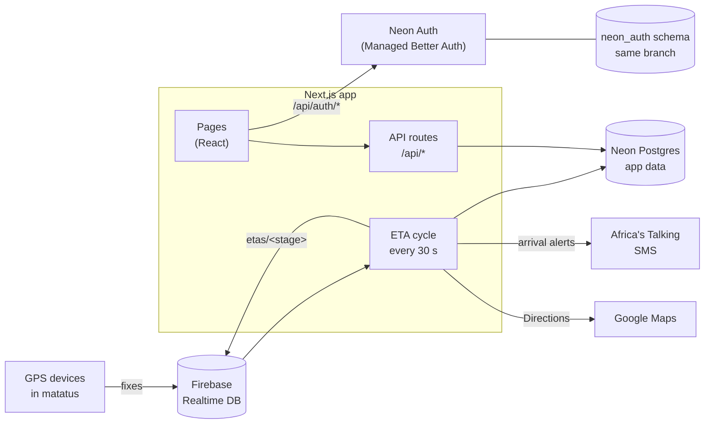

# MatConnect

**Real-time matatu arrivals for passengers, fleet visibility for operators.**

[](https://github.com/cliffkoome/MatConnect/actions/workflows/ci.yml)
[](https://github.com/cliffkoome/MatConnect/actions/workflows/deploy-migrations.yml)


[](LICENSE)

MatConnect turns live GPS from IoT devices in matatus (Kenyan minibuses) into arrival times at each
stage. Passengers see what's coming and get an SMS when their ride arrives. System admins run the
network of stages, routes, vehicles and users. Matatu owners track their fleet's trips, distance and
rider feedback.

---

## Contents

- [Problem and constraints](#problem-and-constraints)
- [Features](#features)
- [How it works](#how-it-works)
- [Design decisions and trade-offs](#design-decisions-and-trade-offs)
- [Failure modes](#failure-modes)
- [Scaling](#scaling)
- [Tech stack](#tech-stack)
- [Getting started](#getting-started)
- [Configuration](#configuration)
- [Deployment](#deployment)
- [Operations](#operations)
- [Security](#security)
- [Testing & CI/CD](#testing--cicd)
- [API](#api)
- [Limitations and roadmap](#limitations-and-roadmap)
- [Project layout](#project-layout)
- [Contributing](#contributing)

---

## Problem and constraints

Matatus don't run to a timetable. Passengers wait at a stage without knowing whether the next vehicle
is two minutes or twenty away, and owners have no reliable record of how far each vehicle went or how
many trips it made. The design follows from a few constraints:

- **The devices are fixed.** GPS units already push positions to Firebase Realtime Database. There is
  no ingestion API to design and no firmware to change.
- **Counts must be right.** Trips and distance feed owners' reports, and a passenger alert should arrive
  once. Every write that counts something has to be safe against retries, overlapping runs and partial
  failures.
- **No dedicated infrastructure.** One Next.js app and a Neon Postgres project, deployable on a single
  VM or on serverless functions, with no queue, Redis or worker fleet required.
- **Third-party APIs fail and cost money.** Google Directions is paid per call and SMS is paid per
  message, so both are called as little as possible and neither is allowed to corrupt the counts.

## Features

| Role | What they can do |
| --- | --- |
| **Passenger** | Pick a stage and watch live ETAs (refreshed every 30 s) · subscribe to a one-time SMS alert for the next arrival · rate rides · manage their profile |
| **Admin** | Live fleet status with street-level locations · create stages and assign vehicles to routes · vehicle registry · user management (search, filter by role, block, delete, add Admins and Matatu admins by email) · feedback feed |
| **Matatu admin** (owner) | Today's fleet totals · per-vehicle distance and trips for any day · daily / weekly / monthly charts with PNG export · CSV fleet report · register their own vehicles |

Everyone signs in with email and password (verified by an emailed code) or with Google.

## How it works



**ETA cycle.** Every 30 seconds the app reads the latest GPS fix for every vehicle from Firebase and,
for each stage, classifies the vehicles on its route:

- outside a 5 km geofence → *Too Far* (no Maps call);
- within 50 m in a straight line → *Arrived* (no Maps call);
- otherwise *Approaching*, with a traffic-aware ETA from Google Directions, or *Departed* if its heading
  points away from the stage.

Results are published to Firebase `etas/<stage>`. On each arrival the cycle counts one trip and texts
subscribed passengers. It also adds up each vehicle's daily distance. A lease row in `job_locks` makes
sure only one cycle runs at a time, however many app instances or cron calls there are. Each run works
to a time budget that ends before its lease does.

**Request path.** Every API route goes through one `route()` wrapper. It applies the per-IP rate limit,
checks the Neon Auth session, and loads the caller's `users` row; role and blocked flag are read fresh
on every request, so changes apply immediately. Input is validated with Zod, and errors come back in
one JSON shape: `{ message, errors?: [{ field, message }] }`.

**Identity.** [Neon Auth](https://neon.com/docs/auth/overview) owns users, passwords, sessions, Google
sign-in, email verification and password reset. It stores them in the `neon_auth` schema of the same
Neon branch as the app data, so a database branch also branches its users. The browser reaches it
through the same-origin proxy `/api/auth/[...path]`, and sessions are httpOnly cookies. MatConnect's
own `users` table holds the role, phone number and blocked flag, linked by `auth_user_id`:

- the first verified sign-in on a new database becomes the **Admin**;
- someone an Admin added by email gets that **role** when they sign up with that email;
- everyone else is a **Passenger**.

## Design decisions and trade-offs

Each decision has a record in [docs/adr](docs/adr) with the options that were considered.

| Decision | Why | Cost |
| --- | --- | --- |
| [Two stores](docs/adr/0001-two-stores.md): Firebase for live positions, Postgres for everything counted or owned | Devices already write to Firebase; constraints and transactions belong in Postgres | Two failure domains; the ETA cycle is the only bridge between them |
| [One leased job](docs/adr/0002-eta-cycle-as-a-leased-job.md) with interchangeable triggers (timer, cron endpoint, worker) | Runs anywhere, with no queue; a lease row works through Neon's pooler where session advisory locks don't | No fencing token, so every side effect is also guarded on its own |
| [Arrival from GPS, leaving with hysteresis](docs/adr/0003-arrival-and-trip-counting.md) (arrive ≤ 50 m, leave > 150 m from every stage served) | Cached Maps routes are coarser than the arrival radius; dropouts and errors must not look like leaving | A vehicle on the far side of a dual carriageway can count as arrived |
| [Claim-then-send alerts](docs/adr/0004-claim-then-send-alerts.md) | Deleting the subscription is an atomic claim, so overlapping runs can't text twice | A crash between the claim and the send loses that one alert |
| [Neon Auth for identity, app-owned roles](docs/adr/0005-identity-and-roles.md) | No credential storage; role and block are read on every request, so they take effect immediately | One primary-key lookup per request |
| [Local business day](docs/adr/0006-business-day.md) | Trips after midnight in Nairobi belong to the new day, not the UTC one | One zone per deployment |

## Failure modes

| Failure | What happens | Why counts stay correct |
| --- | --- | --- |
| Two app instances, or a cron call plus the in-process timer | The second run finds the lease taken and skips | `job_locks` lease; each run ends before its lease expires |
| A run is slow (Maps timeouts) | It stops starting new stages when its budget is spent and reports `truncated: true` | Unpublished ETAs refresh next run; distance is measured from the last saved position, so nothing is lost |
| Serverless function near `maxDuration` | The cron endpoint caps each run's budget by the time left, and skips the second run if too little remains | The run finishes and releases its lease, so the next minute's run isn't blocked |
| Google Maps down or key missing | ETAs show *No Route* | Arrival and trips don't use Maps |
| GPS dropout while a vehicle waits at a stage | Vehicle shows *Offline* | Leaving needs a fix more than 150 m away, so the stop isn't counted twice |
| SMS rejected or the call throws | Logged | The subscription is restored and retried on the next arrival |
| Two vehicles arrive at one stage in the same run | One text per subscriber | Only the run that deletes the subscription row sends |
| Firebase write fails for one stage | That stage is skipped and counted in `errors` | Stages are isolated; other stages and the distance phase still run |
| Two people sign in to a brand-new deployment at once | Exactly one becomes Admin | Provisioning takes a transaction-scoped advisory lock before counting users |
| Postgres unreachable | API calls fail; `/api/health` returns `503 degraded` for monitoring | Trip and distance updates run in transactions, so nothing is half-written |

## Scaling

Today the bottleneck is the ETA cycle, not the web tier. Web instances are stateless apart from
rate-limit counters. The cycle is one job processing stages in sequence, and the 45-second budget
means the slowest stages decide how many stages fit in one run.

| Pressure | What changes |
| --- | --- |
| More stages than one run can finish | Shard the lease (`eta-cycle:<shard>`) by stage group so several workers share the work; process stages with bounded concurrency inside a run |
| Maps cost | Replace one Directions call per vehicle with one Distance Matrix call per stage (up to 25 origins); the geofence and GPS-based arrival already skip most calls |
| Fleet size | Reading the whole `locations` node every 30 s is O(fleet); switch to child listeners in a long-running worker, or have devices write a timestamped fix and read only recent ones |
| Passenger reads | `/api/eta/:stage` recomputes from cached positions and routes; serve the cycle's published snapshot instead so reads never touch Maps |
| Global rate limits behind a load balancer | Back `RateLimiter` (`src/server/http/rate-limit.ts`) with Redis |
| Alerts beyond one message type | Move from claim-then-send to an outbox table with a sender and retries |

## Tech stack

| Layer | Choice |
| --- | --- |
| Web framework | [Next.js 16](https://nextjs.org) (App Router, route handlers, `proxy.ts`), React 19 |
| Language | TypeScript (strict); Zod at every input boundary |
| Database | PostgreSQL on [Neon](https://neon.com): serverless driver on Neon, `node-postgres` elsewhere |
| ORM & migrations | [Prisma 7](https://www.prisma.io) with reviewed SQL migrations and enforced safety rules |
| Auth | Neon Auth (Managed [Better Auth](https://better-auth.com)) via `@neon/auth` |
| Live location | Firebase Realtime Database (`firebase-admin`) |
| Routing & ETAs | Google Maps Directions API |
| SMS | Africa's Talking |
| Charts | Chart.js |
| Tests | Vitest: unit, route-level, and integration against real Postgres |
| CI/CD | GitHub Actions: checks, migration safety, Neon preview branches, production migrations |

## Getting started

**Prerequisites:** Node.js 22+, a [Neon](https://console.neon.tech) account and the Neon CLI
(`npx neon@latest`, no install needed).

```bash
git clone https://github.com/cliffkoome/MatConnect && cd MatConnect
npm install                              # also runs `prisma generate`
cp .env.example .env

npx neon@latest login
npx neon@latest checkout dev --create    # your own Neon branch (expires after 7 days);
                                         # writes DATABASE_URL*, NEON_BRANCH and NEON_AUTH_* to .env
```

Set `NEON_AUTH_COOKIE_SECRET` in `.env` to 32+ random characters:

```bash
node -e "console.log(require('crypto').randomBytes(48).toString('base64url'))"
```

Then create the schema and start the app:

```bash
npm run db:migrate:deploy   # apply migrations to your branch
npm run db:seed             # optional: demo stages, vehicles and one user per role (see SEED_*_EMAIL)
npm run dev                 # http://localhost:3000
```

Sign up at `/signup`. The first account on a fresh branch becomes the Admin. Live ETAs, maps and SMS
need the optional integration variables below; without them the app still runs and those features
switch themselves off.

## Configuration

All configuration is through environment variables, validated at startup by `src/server/env.ts`.
`.env.example` lists every one.

| Variable | Required | Purpose |
| --- | --- | --- |
| `DATABASE_URL` | ✅ | Pooled Neon connection string (host contains `-pooler`), used at runtime |
| `DATABASE_URL_UNPOOLED` / `DIRECT_URL` | for migrations | Direct connection for the Prisma CLI. The Neon CLI writes the first; `DIRECT_URL` wins if set |
| `NEON_AUTH_BASE_URL` | ✅ | Neon Auth URL of the branch (written by the Neon CLI) |
| `NEON_AUTH_COOKIE_SECRET` | ✅ | 32+ characters; signs the cached session cookie. Use a different value per environment |
| `APP_URL` | production | Public origin of the app, e.g. `https://matconnect.example.com` |
| `APP_TIME_ZONE` | no | IANA zone that decides which day a trip counts under (default `Africa/Nairobi`) |
| `FIREBASE_CREDENTIALS_BASE64` | for live ETAs | Base64 service-account JSON (`base64 -w0 key.json`) |
| `FIREBASE_DATABASE_URL` | for live ETAs | Realtime Database URL |
| `GOOGLE_MAPS_API_KEY` | for ETAs | Directions API key |
| `AFRICAS_TALKING_API_KEY`, `AFRICAS_TALKING_USERNAME` | for SMS | The `sandbox` username uses the sandbox API |
| `ETA_CYCLE_MODE` | no | `interval` (default when self-hosted), `cron` (default on Vercel) or `off` |
| `CRON_SECRET` | with `cron` | 16+ characters; required by `/api/cron/eta-cycle` |
| `DATABASE_DRIVER` | no | Force `neon` or `pg` (otherwise detected from the host) |

Neon Auth settings (sign-in methods, verification, email sender, OAuth apps, trusted domains) are
managed per branch with `npx neon@latest neon-auth …`, not in `.env`.

## Deployment

MatConnect is a single Next.js app plus a Neon project. Any Node.js 22 host works.

| Host | Build / start | ETA cycle |
| --- | --- | --- |
| VM or container | `npm ci && npm run build && npm start` | in-process every 30 s (default) |
| Vercel Pro | automatic | Vercel Cron calls `/api/cron/eta-cycle?runs=2` every minute (two cycles 30 s apart); set `CRON_SECRET` and add the `vercel.json` below |
| Vercel Hobby / other serverless | automatic | an external scheduler calling `/api/cron/eta-cycle` with `Authorization: Bearer $CRON_SECRET`, or `ETA_CYCLE_MODE=off` plus `npm run eta:worker` on a small VM |

```json
{ "crons": [{ "path": "/api/cron/eta-cycle?runs=2", "schedule": "* * * * *" }] }
```

Vercel Hobby only allows daily crons and rejects this file at deploy time.

### Production checklist

- [ ] App environment set from the Neon **production** branch: `DATABASE_URL`, `NEON_AUTH_BASE_URL`,
      a production-only `NEON_AUTH_COOKIE_SECRET`, and `APP_URL`
- [ ] GitHub `production` environment secret `DATABASE_URL_DIRECT_PRODUCTION` (direct URL) so
      **Deploy migrations** can run; add required reviewers to that environment to gate it
- [ ] Optional: repository variable `NEON_PROJECT_ID` and secret `NEON_API_KEY` to turn on per-PR
      Neon preview branches
- [ ] Production origin trusted by Neon Auth: `npx neon@latest neon-auth domain add https://<your-domain>`
- [ ] Your own Google OAuth app: `npx neon@latest neon-auth oauth-provider` (Neon's shared credentials
      are for development and show Neon branding)
- [ ] Custom SMTP for auth emails: `npx neon@latest neon-auth config email-provider`
- [ ] Production keys for Firebase, Google Maps and Africa's Talking (a real username, not `sandbox`)
- [ ] An uptime check on `GET /api/health`
- [ ] Sign up first with the email that should become the Admin

## Operations

- **Health:** `GET /api/health` returns `200 {"status":"ok","database":"ok"}`, or `503` when Postgres is
  unreachable. Use it for uptime monitoring and post-deploy smoke tests.
- **Schema changes** reach production only through the **Deploy migrations** workflow after a merge to
  `main`. It applies pending migrations, then fails if the database doesn't exactly match
  `schema.prisma`. Read [docs/MIGRATIONS.md](docs/MIGRATIONS.md) before changing the schema.
- **Rollback and recovery:** branch production in Neon before a risky migration. Neon branches restore
  instantly and include auth state. Never edit a merged migration; fix forward with a new one.
- **Development branches:** `npx neon@latest checkout <name> --create` gives each developer an isolated
  copy of the database and Neon Auth. `neon.ts` gives new branches a 7-day expiry.
- **Logs:** server logs are prefixed by subsystem (`[eta-cycle]`, `[firebase]`, `[sms]`, `[auth]`,
  `[api]`). An integration that isn't configured logs once and switches itself off instead of failing.
- **ETA cycle reports:** every run returns `{ stages, vehiclesOnline, arrivals, tripsCounted, smsSent,
  errors, truncated, durationMs }`, which the cron endpoint returns as JSON. Alert on `errors > 0` or
  `truncated: true` repeating across runs.

## Security

- **Sessions** are httpOnly cookies set by Neon Auth through a same-origin proxy; no tokens are kept in
  `localStorage`. Better Auth checks the `Origin` of state-changing requests.
- **Authorisation** is enforced on the server for every API call: a verified email is required, and the
  role and blocked flag are read from the database each time. Page guards only decide what to render.
- **Email ownership** is proven with a code before an account can sign in, because roles are assigned
  by email.
- **Rate limits** per IP: auth 100 / 15 min, API 100 / 15 min, admin 50 / 15 min, dashboards 30 / min,
  SMS subscriptions 30 / 10 min.
- **Headers:** HSTS, `X-Frame-Options: DENY`, `nosniff`, a strict referrer policy and a restrictive
  `Permissions-Policy` on every response; `X-Powered-By` is turned off.
- **Input** is validated with Zod at every boundary. Database errors map to safe responses (`409` for
  duplicates, `404`, `400`) and never expose SQL.
- **Server-only code** (`src/server/**`) can't reach the browser: a lint rule blocks client imports,
  and the `server-only` package fails the build if one slips through.
- **Cron** requests must carry `CRON_SECRET`, compared in constant time.

To report a vulnerability, please use a private
[GitHub security advisory](https://github.com/cliffkoome/MatConnect/security/advisories/new)
rather than a public issue.

## Testing & CI/CD

```bash
npm run lint && npm run typecheck   # ESLint + tsc
npm test                            # unit and route-level tests, no database needed
npm run test:integration            # against a real, migrated Postgres in DATABASE_URL
npm run db:migrate:check            # migration safety rules
```

Integration tests **truncate every table**. Point them at a throwaway database or Neon branch, never at
production.

| Workflow | Runs on | What it does |
| --- | --- | --- |
| `ci.yml` | every push and PR | lint, typecheck, tests, build; migration rules and drift check; full migration history applied to a fresh Postgres 17; integration tests; seed |
| `neon-preview.yml` | PRs, once configured | a Neon branch copied from production with the PR's migrations applied; deleted when the PR closes |
| `deploy-migrations.yml` | merges to `main` that touch the schema | `prisma migrate deploy` to production, then checks production matches the schema |

## API

JSON over HTTPS. Errors are always `{ message, errors? }`. `api-tests.http` has a ready-to-run request
for every endpoint (VS Code REST Client).

| Area | Endpoints | Access |
| --- | --- | --- |
| Auth (Neon Auth) | `POST /api/auth/sign-up/email`, `/sign-in/email`, `/sign-in/social`, `/sign-out`, `/email-otp/*` · `GET /api/auth/get-session` | public |
| Profile | `GET`, `PUT /api/auth/me` · `GET /api/auth/me/{admin,mat-admin,passenger}` | signed in |
| Stages & ETAs | `GET /api/stages` · `GET /api/eta/:stageId` · `/api/stages/:stageId/{subscription,subscribe,unsubscribe}` | signed in |
| Feedback | `GET /api/feedback/vehicles` · `POST /api/feedback` | Passenger |
| Admin | `/api/admin/{dashboard-data,users,stages,vehicles,feedback,mat-admins}` and sub-routes | Admin |
| Fleet | `/api/mat-admin/{dashboard-summary,dashboard-data,vehicle-stats,fleet-aggregate-data,vehicles}` and chart data | Matatu admin |
| System | `GET /api/health` · `GET /api/cron/eta-cycle` | public · `CRON_SECRET` |

Page URLs from the first version (`*.html`) permanently redirect to their new routes.

## Limitations and roadmap

- **Stale positions.** Fixes in Firebase carry no timestamp, so a device that stops reporting leaves its
  last position in place and the vehicle keeps an ETA. The fix is a firmware change to write
  `updatedAt` with each fix; the cycle would then mark older fixes *Offline*.
- **Two ETA paths.** The cycle publishes ETAs to Firebase, while `/api/eta/:stage` computes its own from
  the same cached inputs. Serving the published snapshot would make the cycle the only writer.
- **Firebase keys use stage names.** Renaming a stage leaves the old `etas/<name>` node behind. Keying by
  stage ID is a breaking change for anything that reads Firebase directly, so it waits for a versioned
  path (`etas/v2/<id>`).
- **Historical days.** Trips recorded before the move to local days stay on their UTC day (see
  [ADR-0006](docs/adr/0006-business-day.md)).

## Project layout

```
src/
├─ app/                    pages and API route handlers (HTTP only: validate → service → JSON)
│  └─ api/auth/[...path]/  Neon Auth proxy
├─ proxy.ts                Neon Auth middleware for pages
├─ server/                 server-only code
│  ├─ http/                route() wrapper, errors, rate limiting
│  ├─ auth/                Neon Auth instance and the API guard
│  ├─ modules/<feature>/   business logic: auth, admin, mat-admin, stages, eta, feedback, vehicles
│  ├─ domain/              pure logic: ETA classification, geo maths, periods, phone numbers
│  ├─ integrations/        Firebase, Google Maps, Africa's Talking
│  ├─ jobs/                ETA cycle, job lease, scheduler
│  └─ db.ts, env.ts        Prisma client and validated environment
├─ lib/                    browser auth client, API client, hooks
└─ components/, styles/    shared UI and page styles
prisma/                    schema, migrations, seed
tests/                     unit/, api/, integration/
scripts/                   migration checker, standalone ETA worker
docs/adr/                  architecture decision records
docs/MIGRATIONS.md         database change rules
neon.ts                    Neon project policy (services, branch expiry)
```

## Contributing

1. Branch from `dev`, and create your own Neon branch with `npx neon@latest checkout <you> --create`.
2. Keep route handlers thin: logic goes in `src/server/modules`, pure rules in `src/server/domain`,
   with tests next to the change.
3. For schema changes, edit `prisma/schema.prisma`, run `npm run db:migrate:create -- --name <change>`,
   review the SQL and follow [docs/MIGRATIONS.md](docs/MIGRATIONS.md).
4. Run lint, typecheck and tests, then open a PR. CI must pass, and migrations reach production only
   by merging to `main`.

---

[ISC](LICENSE) © 2025-2026 Clifford Karani
